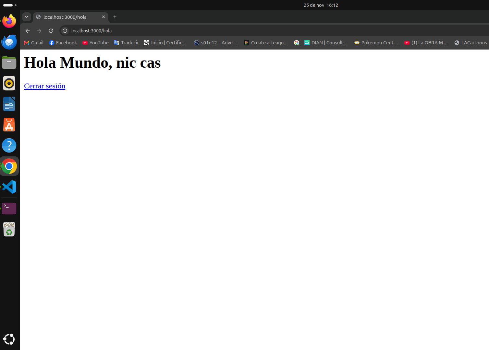

# Keycloak con autenticación externa (Google) y aplicación dummy

Keycloak en local con Docker, un realm propio con login federado de Google y una app "Hola Mundo" en Node.js que inicia sesión a través de Keycloak con el flujo Authorization Code.

## 1. Keycloak en Docker

Keycloak corre con la imagen oficial `quay.io/keycloak/keycloak` en modo `start-dev`. El volumen `./keycloak_data:/opt/keycloak/data` guarda la configuración para que no se pierda al reiniciar el contenedor.

```bash
mkdir -p keycloak_data
sudo chown -R 1000:0 keycloak_data
docker compose up -d
```

La consola de administración queda en `http://localhost:8080`.

## 2. Configuración en la consola de Keycloak

- Realm `semillero`, separado de `master`.
- Roles de realm `usuario` (asignado por defecto) y `admin`.
- Cliente `hola-mundo-app` confidencial, con Standard flow (Authorization Code):
  - Valid redirect URIs: `http://localhost:3000/callback`
  - Valid post logout redirect URIs: `http://localhost:3000`

## 3. Login con Google

- En Google Cloud Console se creó un proyecto, se configuró la pantalla de consentimiento (público externo, en prueba, con usuarios de prueba) y un cliente OAuth de tipo Aplicación web con la URI de redireccionamiento:
  `http://localhost:8080/realms/semillero/broker/google/endpoint`
- En Keycloak se agregó Google como Identity Provider en el realm `semillero`, con el ID de cliente y el secreto obtenidos de Google.

## 4. API "Hola Mundo"

App en Node.js con Express y `express-openid-connect` (carpeta `app/`). La ruta `/login` redirige a Keycloak, `/callback` recibe el código de autorización y `/hola` muestra "Hola Mundo, <usuario>" cuando hay sesión.

La configuración va en `app/.env`, que se crea a partir de `app/.env.example` y no se sube al repositorio.

## 5. Ejecución y prueba

```bash
cd app
cp .env.example .env   # completar KEYCLOAK_CLIENT_SECRET y SESSION_SECRET
npm install
npm start
```

Al abrir `http://localhost:3000` e iniciar sesión con Google a través de Keycloak, la app muestra el saludo:

